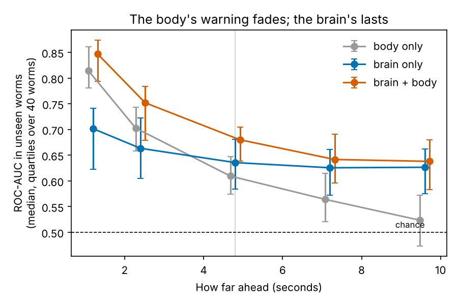
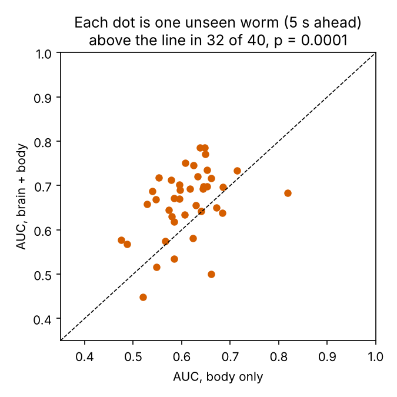
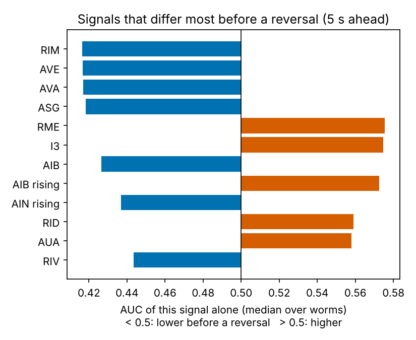

# Predicting C. elegans reversals from whole-brain activity

[](https://github.com/xsaiki-design/c-elegans-behavior-prediction/actions/workflows/tests.yml)
**[Try the interactive page](https://xsaiki-design.github.io/c-elegans-behavior-prediction/)**: pick an unseen worm,
watch the model's risk rise before real reversals, and set your own alarm.

**Question:** while a worm crawls forward, can its brain activity tell us it is about to reverse, beyond what its body
already shows, in a worm the model has never seen?

**Answer: yes, modestly.** Predicting a reversal ~5 s ahead, brain + body signals score a median ROC-AUC of **0.68** in
held-out worms vs **0.61** for body signals alone, better in **32 of 40** worms (p = 0.0001). The body's warning fades
within seconds; the brain's lasts at least 10 s.



Full write-up: [`docs/writeup.md`](docs/writeup.md) (2–3 pages: method, results, checks, limitations).

## Key results

| Signals used | Median AUC, 5 s ahead, unseen worms |
|---|---|
| Body only (speed, head angle, time since last reversal) | 0.61 |
| Brain only (46 named neuron classes) | 0.64 |
| **Brain + body** | **0.68** (better than body in 32/40 worms, p = 0.0001) |

- **Checks:** sliding the brain recording out of sync with behaviour removes the effect (brain alone 0.52, brain + body
  back to 0.61). Stricter scaling gives the same result (0.68, 33/40). Decoding the *current* behaviour is easy (0.89),
  which confirms the pipeline lines up.
- **As an alarm** (same number of alarms for both models): the body is the better *last-second* detector, because the
  worm slows down just before it reverses. With at least 3 s of warning required, the brain model catches more reversals
  in 27 of 40 worms. [Table](docs/writeup.md#as-an-alarm-early-warning-vs-last-second-detection)
- **Which neurons:** AIB rising is the clearest build-up signal. AVA/AVE/RIM look *lower* before reversals, but that
  turns out to be leftover activity from the previous reversal. [Details](docs/writeup.md#results)
- **A stronger model agrees** (exploratory): boosted trees 0.70 vs 0.65, better in 33/40 worms.
- **All choices were fixed before any results** and committed in git: [`docs/decisions/`](docs/decisions). One slip
  (head angle missing from the body baseline) was caught in review, fixed and re-run; it's
  [logged](docs/decisions/0004-evaluation.md#correction-log).

<p>


</p>

## Data

Whole-brain calcium imaging of freely moving *C. elegans* from
[Atanas & Kim et al. 2023, *Cell*](https://doi.org/10.1016/j.cell.2023.07.035): 40 recordings with every neuron named
(NeuroPAL), ~16 minutes and ~140 neurons each. Why this dataset: [0001](docs/decisions/0001-dataset.md).

## How it works

| Step | Choice | Why |
|---|---|---|
| Target | From forward-moving frames: does a reversal start within ~5 s? | [0002](docs/decisions/0002-question.md) |
| Features | Named neuron classes, scaled per worm, plus recent change | [0003](docs/decisions/0003-features-across-worms.md) |
| Test | Leave one worm out; must beat a body-only baseline | [0004](docs/decisions/0004-evaluation.md) |

## Run it

Needs [uv](https://docs.astral.sh/uv/). About 5 minutes on a laptop.

```bash
uv sync                            # install the exact package versions
uv run python -m worms.download    # fetch and checksum the data (~570 MB) into data/
uv run pytest                      # tests
uv run python -m worms.run         # analysis -> results/summary.json
uv run python -m worms.figures     # figures/ from the results
uv run python -m worms.demo_data   # held-out predictions for the interactive page -> docs/demo-data.json
uv run python -m worms.alarms      # alarm analysis -> results/alarms.json
```

To view the interactive page locally: `python -m http.server -d docs`, then open http://localhost:8000.

## Layout

```
worms/data.py       load one worm: traces, reversal labels, speed, neuron names, heat-stimulus time
worms/download.py   download + verify the dataset
worms/features.py   prediction target, neuron-class features, body-only baseline features
worms/evaluate.py   leave-one-worm-out scoring
worms/run.py        the pre-set analysis; settings mirror docs/decisions
worms/figures.py    README figures
worms/explore.py    exploratory: a stronger model (boosted trees)
worms/demo_data.py  exports held-out predictions for the interactive page
worms/alarms.py     exploratory: reversals caught with equal alarms, by warning time
docs/index.html     the interactive page (GitHub Pages)
tests/              tests
docs/               write-up, decisions with references, reading list
```

## Limitations

A modest effect (AUC 0.68 is early warning, not mind reading); one dataset from one lab; only named neurons can be
compared across worms; calcium is a slow proxy for activity; single-neuron scores are associations, not causes. More in
the [write-up](docs/writeup.md#limitations).

## How this relates to the dataset paper

The paper models how each neuron *encodes* ongoing behaviour. This project goes the other way and forward in time: from
the population to an *upcoming* reversal, tested on unseen animals against a body-only baseline. It's a focused
extension of their data, not a new dataset or method. [More](docs/writeup.md#how-this-relates-to-the-dataset-paper)

## How this was built

Built with help from Claude Code (an AI coding assistant). Every design decision, its reasoning and its alternatives are
in [`docs/decisions/`](docs/decisions); the reading list for the concepts is [`docs/reading-list.md`](docs/reading-list.md).

## Data credit

Data: Atanas, Kim et al., *Cell* 186 (2023), Flavell lab, MIT. Please cite the paper, not this repository.
