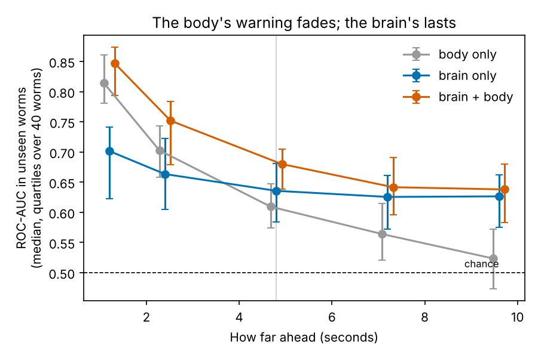
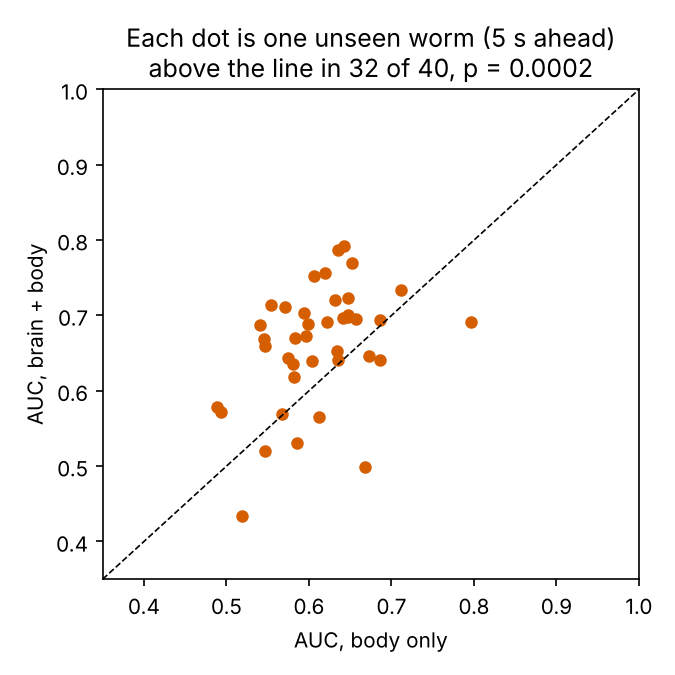
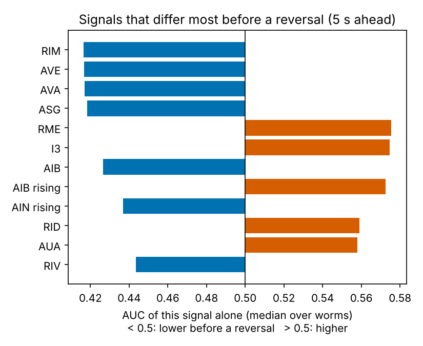

# Whole-brain activity gives early warning of reversals in unseen worms

*Write-up, 2026-11. Code and decisions: this repository. Data: Atanas & Kim et al. 2023.*

## Question

While a *C. elegans* worm crawls forward, does its whole-brain activity show that it is about to reverse, beyond what its
body already shows, in an animal the model has never seen?

## Answer

**Yes, modestly.** Predicting whether a reversal starts in the next ~5 s, a model using brain activity plus body signals
scored a median ROC-AUC of **0.68** in held-out worms, against **0.61** for body signals alone. It did better in
**32 of 40** worms (median gain +0.06, Wilcoxon signed-rank p = 0.0002). The early warning from the body fades within a
few seconds; the brain's stays above chance at least 10 s ahead.

## Data

Whole-brain GCaMP imaging of freely moving worms ([Atanas & Kim et al. 2023](https://doi.org/10.1016/j.cell.2023.07.035)),
processed traces from [Zenodo](https://zenodo.org/records/19388374). 40 recordings have NeuroPAL neuron identities; those
are the ones used. ~16 min each at ~1.6 frames/s, ~140 neurons per worm. 18 of the 40 received a heat stimulus partway;
only frames before it are used. Details and caveats: [decision 0001](decisions/0001-dataset.md).

## Method

All choices below were written down and committed before any results were computed (decisions
[0002](decisions/0002-question.md), [0003](decisions/0003-features-across-worms.md), [0004](decisions/0004-evaluation.md)).

- **Samples:** every frame where the worm is moving forward. **Label:** does a reversal start within the next 8 frames
  (≈ 5 s)? A median 35 % of frames say yes (17–64 % across
  worms).
- **Brain features:** the 46 neuron classes named in at least 25 of 40 worms, each neuron z-scored within its worm,
  left/right averaged; plus each class's change over the last ~3 s. Classes not found in a worm are set to its average (0).
- **Body features:** current velocity and time since the last reversal.
- **Model:** logistic regression, scikit-learn defaults.
- **Test:** leave one worm out: train on 39, score the 40th, for every worm. ROC-AUC and average precision per worm.
- **Headline comparison:** brain + body vs body alone, paired over worms.

## Results

| Signals used | Median AUC, 5 s ahead | Notes |
|---|---|---|
| Body only | 0.61 | velocity, time since last reversal |
| Brain only | 0.64 | not significantly better than body alone (25 of 40 worms, p = 0.26) |
| **Brain + body** | **0.68** | better than body in 32 of 40 worms, p = 0.0002 |

**How far ahead (figure above).** At 1 s ahead the body is already a strong predictor (AUC 0.82): the worm slows
before it reverses (slowing alone scores 0.82). Its value drops fast, to near chance (0.52) at ~10 s. Brain-only accuracy falls much less, from
0.70 to 0.63. Brain information about an upcoming reversal seems to build up over several seconds, ahead of anything
visible in the body.

**Which signals (figure below).** Scoring each signal on its own:

- **AIB rising** (AUC 0.57) is the clearest build-up signal: AIB is an interneuron known to promote reversals
  ([Gray et al. 2005](https://doi.org/10.1073/pnas.0409009101)), and its activity climbs in the seconds before a reversal.
  RME, I3, RID and AUA are also slightly higher (0.56–0.58).
- **AVA, AVE and RIM are *lower* before a reversal** (0.42), which looks backwards for "reversal neurons". The data
  explains it: their level mostly tracks time since the *previous* reversal (rank correlation −0.67 for AVA). They're
  still winding down after one, and another reversal is unlikely that soon. Away from recent reversals (≥ 9 s), AVA
  alone is near chance (0.47). So their low level is mostly a timing signal, not a decision signal.
- Lesson for reading these scores: a single neuron's score mixes "what's coming" with "what just happened".

**Checks.**
- *Pipeline sanity (decoding):* telling whether the worm is reversing *right now* from brain activity gives AUC 0.89. As
  expected it's easy, which shows the features and labels line up. It isn't the finding.
- *Stricter scaling:* scaling each neuron with only the first 3 minutes (no information from later frames) gives the same
  answer: AUC 0.68, better in 33 of 40 worms, p < 0.0001.
- *Label alignment:* AVA correlates with reversing (+0.36) and the forward neurons AVB and RIB against it (−0.50, −0.60);
  shifting labels by one column removes this (−0.06).

## Limitations

- **The effect is modest.** AUC 0.68 means the model ranks a "reversal coming" moment above a "no reversal" moment 68 %
  of the time. It's useful early warning, not mind reading.
- **One dataset, one lab, one microscope.** Whether it holds elsewhere is untested.
- **Only named neurons.** About a third of each worm's neurons have no name and can't be matched across animals, so
  they're unused. Missing classes are filled with an average, which hides some differences between worms.
- **Calcium is a slow proxy** for neural activity. Its delay works against early warning, so if anything the lead time
  is underestimated.
- **Single-signal scores show association, not cause.** A neuron that rises before reversals may be reacting to the
  same inputs rather than driving the decision.
- **Heat-stimulated worms contribute fewer frames** (before the stimulus only), so they weigh less.
- **One simple model.** Nonlinear models might do better; that would be exploratory and is not tried here.

## How this relates to the dataset paper

Atanas & Kim et al. 2023 asked how each neuron *encodes* behaviour. They modelled each neuron's activity as a function of
the worm's ongoing behaviour (velocity, head curvature, feeding), mapping which neurons represent what, over which
timescales, and how that changes with state. This project goes the other way and forward in time: from the population
to an *upcoming* behavioural event. It tests that on unseen animals against a body-only baseline, to measure how much
early warning the brain adds. The finding that brain information outlasts body information fits their multi-timescale
picture; it is a small, focused extension of their data, not a new dataset or method. *(The comparison is based on the
paper's summary; check its decoding analyses before claiming that nobody has done this.)*

## How this was built

Code written with help from Claude Code (an AI coding assistant). Every design decision, with its reasoning and the
alternatives, is in [`docs/decisions/`](decisions); the plan was committed to git before results were computed.
